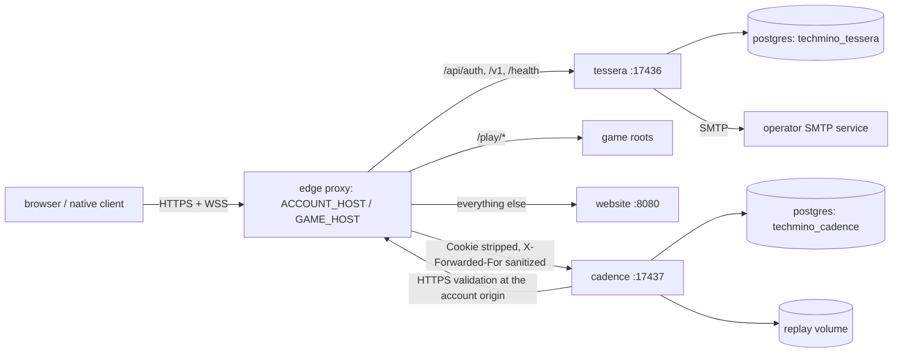

# Techmino online deployment

Self-hosted Docker Compose deployment for the rewritten Techmino online stack:
**Tessera** (accounts, product sessions, website APIs), **Cadence** (connections,
rooms, matches, replays), the static **account website** PWA, and the **edge TLS
proxy** that owns the public origins.

Everything here is operator-owned configuration. The repository contains no
credentials, no production hostnames, and no working certificates: the templates
in this directory are placeholders that bootstrap validates and rejects until
they are replaced.

```
deploy/
  .env.example            operator template (copy to .env, then bootstrap)
  bootstrap.sh            validate .env, generate secrets, write runtime/
  compose.yml             fresh self-hosted stack (own PostgreSQL)
  compose.local.yml       containerized services against the local fixtures
  proxy/Caddyfile         edge TLS proxy: routing, cookie stripping, client IP
  postgres/init/01-roles.sh   least-privilege roles and the two databases
  tools/backup.sh         drained manual backup (databases + replay files)
  tools/restore.sh        restore into isolated new databases, then verify
  game-roots/play/<product>/  real Web/WASM builds served at /play/*
  runtime/                generated, 0700, git-ignored: secrets and TLS copies
```

## Topology



Both services sit on an internal `backend` network with the database, and on a
`frontend` network with the proxy. PostgreSQL has no route to the outside. The
public ports are published only by the proxy.

Three deliberate routing and boundary facts:

* `/api/auth/*`, `/v1/*` and `/health/*` are the only paths proxied to Tessera;
  `/play/*` is served from the game-root directory; every other path is the
  website. The website's SPA fallback therefore never answers an account API,
  and Cadence's readiness probe reaches the real Tessera health endpoint instead
  of an HTML page.
* The game origin **strips `Cookie`** on HTTP and WebSocket requests. Account and
  product-session cookies can never reach Cadence.
* One sanitized client address is forwarded per request. The proxy deletes
  `Forwarded`, `X-Forwarded-For`, `X-Forwarded-Host`, `X-Forwarded-Proto` and
  `X-Real-IP` from the client and sets `X-Real-IP` (for Tessera) or
  `X-Forwarded-For` (for Cadence) to `{remote_host}`. Only the proxy address is
  listed in Tessera's `TRUSTED_PROXY_IPS` and Cadence's
  `CADENCE_TRUSTED_PROXIES`, so a direct client cannot spoof it.

Cadence's readiness probe calls the account origin over TLS
(`{TESSERA_ORIGIN}/health/ready`), so the account hostname must resolve inside
the Cadence container. Compose provides that with a network alias on the proxy
for `ACCOUNT_HOST`. **Do not use `localhost` as a hostname in the containerized
topology**: inside a container `localhost` resolves to that container itself, so
Cadence could never reach the account origin. Use a real name (or a name mapped
in the operator's hosts file) for a local exercise.

## Prerequisites

| Requirement | Notes |
| --- | --- |
| Docker Engine with embedded BuildKit and Compose v2.24+ | Engine 23+ ships BuildKit; verified here on Engine 29.8.1 and Compose 5.5.1 |
| **BuildKit with the `docker buildx` CLI plugin** | mandatory: the Cadence image declares `additional_contexts`, which the classic builder cannot express — see "Build requirements" below |
| Outbound network during image builds | crates.io, npm registry, Docker Hub |
| TLS mode | `manual` uses operator PEM files; `automatic` uses Caddy's public ACME lifecycle and persistent `proxy-data` |
| Real SMTP service | production requires successful authentication and verified TLS; Mailpit is a local fixture only |
| Public DNS and reachable TCP ports | automatic HTTPS needs the configured names to reach the proxy on 80/443; HSTS remains operator-controlled |
| Real game builds | the Web/WASM release builds placed under `game-roots/play/<product>/` |
| Pinned bases | `postgres:18.6-alpine`, `caddy:2.11-alpine`, `oven/bun:1.4.2-slim`, `rust:1.99-bookworm` → `debian:bookworm-slim`, `node:24-bookworm-slim`, `axllent/mailpit:v1.31.4` |

### Build requirements (BuildKit and the buildx plugin)

The Cadence image needs the canonical Techmino checkout as a second build
context, declared as `build.additional_contexts.techmino` in both compose files.
Compose implements that with `docker buildx build --build-context`, so it works
only with BuildKit: [additional_contexts is a Compose 2.17+ feature that requires
the buildx/BuildKit builder](https://docs.docker.com/reference/compose-file/build),
and Compose warns when the configured builder does not support it.

Symptom when the plugin is missing: the build stops before any file is compiled
with `buildx: Docker CLI plugin not found`, or with a warning that additional
contexts are unsupported, because Compose fell back to the classic builder.

Check and satisfy it without root:

```sh
docker compose version          # Compose v2.24 or newer
docker buildx version           # must print a version; this is the real gate
```

If `docker buildx version` fails, install the plugin somewhere the Docker CLI
can see it. The Docker CLI loads CLI plugins from `$DOCKER_CONFIG/cli-plugins`
(`$HOME/.docker/cli-plugins` by default), so a user-writable or project-local
`DOCKER_CONFIG` is enough — no global install and no `sudo`:

```sh
# project-local CLI configuration
mkdir -p .docker/cli-plugins
# place the docker-buildx binary from the Docker Buildx release for this
# architecture at .docker/cli-plugins/docker-buildx, then:
chmod +x .docker/cli-plugins/docker-buildx
DOCKER_CONFIG=$PWD/.docker docker buildx version
DOCKER_CONFIG=$PWD/.docker docker compose -f deploy/compose.yml build cadence
```

Buildx does not need a separate build daemon here: the default `docker` driver
uses the daemon's embedded BuildKit. Paths and naming follow the
[Docker Buildx plugin installation notes](https://github.com/docker/buildx#manual-download).

Verified on the current workstation: Engine 29.8.1, Compose 5.5.1, and
Buildx 0.37.2 through the project-local CLI configuration
`DOCKER_CONFIG=$PWD/.runtime/application/docker-cli`. The default CLI
configuration originally had no buildx plugin; the project-local installation
now builds all three service images without a global installation or `sudo`.

`DOCKER_BUILDKIT=1` alone is not a substitute: Compose v2 drives the buildx
plugin. Only the Cadence image uses `additional_contexts`; the Tessera and
website images build from a single context, so if BuildKit truly cannot be
provided, run Cadence natively from `26FStudioProjects/Cadence` with
`TECHMINO_SOURCE_DIR=<canonical checkout>` and keep the rest of the stack in
containers.

A production run must verify its provisioned host, public DNS, certificate
trust, real SMTP authentication/delivery, real Web/WASM builds, and the
real-device checks assigned to the user by the implementation plan.
Template validation alone establishes none of those results. Legacy account
import is not an implicit bootstrap or deployment operation.

## Fresh stack: bootstrap and start

```sh
cd /home/particleg/coding/26FStudioProjects/Tessera

cp deploy/.env.example deploy/.env
chmod 600 deploy/.env
# replace every REPLACE_WITH_* value; the file is rejected until you do
$EDITOR deploy/.env

deploy/bootstrap.sh --dry-run     # validate and print the plan
deploy/bootstrap.sh               # generate deploy/runtime/ (0700)

docker compose -f deploy/compose.yml config --quiet
docker compose -f deploy/compose.yml up --build -d
docker compose -f deploy/compose.yml ps
```

`docker compose config --quiet` validates the file without printing resolved
values. Do not run plain `docker compose config`: it prints expanded environment
values and would expose the generated secrets on screen.

Bootstrap is fresh-only. It refuses to overwrite an existing `deploy/runtime`
directory, refuses to run when `deploy/.env` still contains placeholders, and
never contacts a database, mail service, or remote host. Secrets are generated
with `openssl rand` and never printed. The database roles themselves are created
once, by `postgres/init/01-roles.sh`, on first initialization of an empty data
directory.

First start performs, in order: PostgreSQL initialization (roles, databases,
grants) → `tessera-migrate` → `tessera` → `cadence-migrate` → `cadence`. The
one-shot migration services run on every `up`; both migration paths are
idempotent (Tessera takes advisory lock `742615125`, Cadence applies its SQL
migrations and then re-applies `sql/grant-application.sql`).

Replay storage is a named volume mounted at `/var/lib/cadence/replays`, the path
the image already owns for the unprivileged Cadence user, so the volume is
writable on first use and survives restarts; do not remount it at another path.

A fully local exercise of this same fresh stack is possible with the fixture CA:
`APP_ENV=development`, `MAIL_MODE=local-fixture`, `--profile local-mail`,
`TESSERA_UPSTREAM_CA=/home/particleg/coding/26FStudioProjects/Tessera/.runtime/application/tls/ca.pem`,
and two names that your hosts file maps to `127.0.0.1` with certificates issued
for them. It creates fresh databases, roles, and replay storage; the fixture
PostgreSQL and the fixture database are not touched.

### Public automatic HTTPS

Set `TLS_MODE=automatic`, use port `443` for both public origins, and leave
`TESSERA_UPSTREAM_CA` empty. The four operator certificate/key fields are unused
in this mode; bootstrap does not require or create placeholder certificates.
Point the public DNS records at this host before starting the proxy.

Use the public port override with Compose 2.24.4 or newer:

```sh
docker compose -f deploy/compose.yml -f deploy/compose.public.yml config --quiet
docker compose -f deploy/compose.yml -f deploy/compose.public.yml up --build -d
```

Caddy obtains and renews certificates using its normal public ACME issuers.
The `proxy-data` volume stores ACME accounts and certificate private keys;
preserve it across container replacement and include it in protected backups.
TCP 80 handles HTTP redirects/challenges and TCP 443 serves HTTPS/WSS. HTTP/3
is not advertised because this topology publishes TCP only. No DNS-provider
credentials are needed in the proxy for these HTTP/TLS challenges.

`TLS_MODE=manual` remains the default for existing operator-managed and local
fixture deployments. It keeps `auto_https off` and loads the supplied PEM files.
Both modes share the same routes, cookie stripping, forwarding-header
sanitization, and credential-safe error logging.

### Public validation deployment (2026-11-10)

The fresh Ubuntu 24.04 deployment is rooted at
`/opt/techmino-online/deploy` on `studio26f.org`. It uses fresh databases, not an
automatic legacy restore. The existing local validation stack and its accounts
remain separate and unchanged.

- Account/website origin: `https://studio26f.org`.
- Game API/WSS origin: `https://game.studio26f.org`.
- Original Web clients: `/play/techmino/` and `/play/techmino-galaxy/` on the
  account origin. Both canvases booted and their account screens displayed
  the configured public origins. Later Galaxy automation logged one
  `TypeError: Permissions check failed`. Its original `Go Fullscreen` control
  subsequently entered actual canvas fullscreen in the foreground without
  another page error; general fullscreen/device acceptance is not claimed.
- The private deployment preserves `www.studio26f.org` with a 308 redirect to
  the canonical account origin. On 2026-11-11, the operator chose to retain
  redirects for `26f.studio` and `www.26f.studio` rather than introduce separate
  login origins. These two HTTPS aliases use temporary 302 redirects, preserving
  paths and query strings while leaving a future domain migration possible.
  Their AliDNS A records already pointed to this server; no DNS-provider
  credentials or DNS changes were needed. Both alias blocks are retained in the
  private local deployment bundle as well as the server Caddyfile, rather than
  added to the generic deployment template.
- Caddy issued publicly trusted Let's Encrypt certificates. Default trust-root
  verification passed for the original three hostnames and both new aliases;
  HTTP upgrades and exact HTTPS redirects were exercised. No fixture CA or
  verification bypass was used. Account/game origins and client callbacks
  remain unchanged.
- Both real `/health/ready` endpoints returned 200. PostgreSQL, Tessera and
  Cadence were healthy with zero container restarts at verification. Only TCP
  80/443 are published by Compose. The named replay volume was writable by
  Cadence's actual UID/GID `10002:10002`.

Images tagged `public-20261110` were built locally using the existing
Dockerfiles and transferred individually to the small server. Its private
`compose.small-host.yml` supplies functional-validation limits; it does not
change the canonical capacity budgets or reverse the earlier 2C2G **FAIL**.
No pressure workload was rerun.

Both clients were pushed to `ci-public-online-validation-20261110`:

- [Techmino run 42743013437](https://github.com/26F-Studio/Techmino/actions/runs/42743013437),
  commit `c92012780874a947cf7eed39dc912302df16f780`: Linux, Windows, Android
  and Web builds passed. The downloaded AppImage actually rendered its GUI
  and exited through the original main-menu controls with exit code 0.
  Its packaged `libtechmino_transport.so`, initialized without a custom CA,
  obtained 200/ready from both public services. This is not public authenticated
  gameplay, physical GPU/audio or protected-store acceptance.
- [Galaxy run 42743761592](https://github.com/26F-Studio/Techmino_Galaxy/actions/runs/42743761592),
  commit `534d68719fd16a6c3dedb32d9768858022062b3a`: Web passed; native jobs
  remain blocked because the original soundbank hostname cannot resolve.
  No substitute banks or native Galaxy audio evidence were produced.
- Apple jobs remained under the existing release-tag/signing gates and did
  not run. Build success is not physical-platform acceptance.

The preserved SMTP configuration verified TLS but failed authentication with
SMTP `535`; the probe sent no message. Registration verification, recovery,
public authenticated product sessions and a public two-user match remain
unverified. The operator must repair SMTP authentication in the protected
`runtime/tessera.env` before Tessera is recreated and those paths are exercised.
Do not publish credentials, substitute public Mailpit, silently seed verified
accounts, or import local test accounts to bypass this prerequisite.


## Roles and least privilege

| Role | Kind | Privileges |
| --- | --- | --- |
| `techmino_admin` | login, PostgreSQL superuser | image initialization only; no service uses it |
| `techmino_tessera_migrator` | login | owns the `techmino_tessera` database and every object in it; runs DDL |
| `techmino_tessera_app` | login, member of `tessera_application` | DML on Tessera tables only |
| `techmino_cadence_migrator` | login | owns the `techmino_cadence` database and every object in it; runs DDL |
| `techmino_cadence_app` | login, member of `cadence_application` | the DML granted by Cadence's `sql/grant-application.sql` |
| `tessera_application` | NOLOGIN group | carries the Tessera runtime grants |
| `cadence_application` | NOLOGIN group | carries the Cadence runtime grants; reuses the established group name |

The runtime roles are `NOSUPERUSER NOCREATEDB NOCREATEROLE`, never own a
database or schema, and cannot create objects. Tessera refuses to start on a
runtime role with any administrative attribute. Cadence's runtime role cannot
read Tessera's tables at all: the two services use separate databases and
separate roles.

## TLS, cookies, and mail

* In `TLS_MODE=manual`, bootstrap copies operator certificates and keys into
  `deploy/runtime/tls/` (public certificates 0644, private keys 0600). The proxy
  uses `auto_https off` with explicit PEM files and does not contact a public CA.
* In `TLS_MODE=automatic`, Caddy owns certificate issuance and renewal in
  `proxy-data`; use `compose.public.yml` and the standard public trust roots.
* `TESSERA_UPSTREAM_CA` is optional. When the account certificate is not publicly
  trusted, set it to the issuing CA: bootstrap copies it to
  `runtime/tls/account-ca.pem` (0644, so the unprivileged Cadence process can
  read it) and Cadence pins that CA for account-origin validation. Never put a
  private key in that file.
* Mail: `MAIL_MODE=smtp` (production) requires a real SMTP host, user and
  password; Tessera forces `SMTP_REQUIRE_TLS` in production. `MAIL_MODE=local-fixture`
  targets the `local-mail` Mailpit profile, requires `APP_ENV=development`, and is
  an isolated inbox fixture — not a claim that mail is delivered.
* Product-session cookies are HttpOnly, `Secure`, `SameSite=Lax`, and scoped to
  `/v1/products/<id>/session`; they are never forwarded to the game origin.
* `TESSERA_RESOURCE_SECRET` is delivered as an environment value from a 0600
  env file. The `*_FILE` variant is the stricter alternative, but the file must
  then already be readable by the unprivileged service user; a bind mount cannot
  fix ownership that bootstrap cannot set.
* Proxy runtime error logs use the global `log default` JSON filter in
  `proxy/Caddyfile`: delete `request>uri`, `request>headers`, `request>remote_ip`,
  `request>remote_port` and `request>client_ip`. Redacting an access logger alone
  does not protect Caddy's default reverse-proxy error records. No access logger
  is added; method, status, timestamp and error diagnostics remain available.
  Actual Caddy 2.11.4 probes used generated noncredential markers: default logs
  exposed them, while the filtered deployment-config account/game TLS failures
  returned 502 without logging the marker or those request fields. The filtered
  fixture proxy was then restarted and real HTTPS readiness passed.

Set `ACCOUNT_ADMIN_IDS` / `CADENCE_GAME_ADMINS` to explicitly configured
account/game administrator IDs. They are deployment configuration and are never
writable through a profile.

## Fixture integration stack

`compose.local.yml` runs the same images against the existing local fixtures
instead of a fresh deployment. Host networking lets the backends reuse the
protected environment files under `Tessera/.runtime/application/` and reach the
existing PostgreSQL at 127.0.0.1:15436. The stack's local-only Mailpit service
receives SMTP at 127.0.0.1:11025 and exposes its inbox at
`http://127.0.0.1:18025`. `deploy/.env` and bootstrap are not used.

The prepared manual runtime uses `.runtime/application/local-manual.env` to
select `.runtime/application/manual-validation-20261020/tls` and `web-games`.
That selector file contains paths only, not application credentials. The old
fixture certificates expired on 2026-10-09 and remain unchanged.

```sh
cd /home/particleg/coding/26FStudioProjects/Tessera
export DOCKER_CONFIG="$PWD/.runtime/application/docker-cli"
docker compose --env-file .runtime/application/local-manual.env \
  -f deploy/compose.local.yml --profile edge build tessera cadence website
docker compose --env-file .runtime/application/local-manual.env \
  -f deploy/compose.local.yml --profile edge \
  up -d --no-build --wait --wait-timeout 120 tessera cadence website proxy mailpit
docker compose --env-file .runtime/application/local-manual.env \
  -f deploy/compose.local.yml --profile edge ps
```

Manual entry points:

* account website: `https://localhost:17445/account/sign-in`;
* Techmino Web: `https://localhost:17445/play/techmino/`;
* Galaxy Web: `https://localhost:17445/play/techmino-galaxy/`;
* game readiness: `https://127.0.0.1:17446/health/ready`;
* local email inbox: `http://127.0.0.1:18025`.

Trust only the selected public `tls/ca.pem` in the browser. Native desktop
clients can add that same absolute path with `TECHMINO_TRANSPORT_CA_FILE`.
Do not import or share `ca.key`, disable TLS verification, or assume the
isolated smoke browser's trust setup changes the user's browser. Both game
roots are real source builds; Galaxy retains its original FMOD-disabled Web
path, not a replacement for unavailable native soundbanks.

Prerequisites and boundaries:

* the existing durable fixture PostgreSQL container is running; no database or
  replay volume is recreated by the command above;
* native Tessera and Cadence are stopped — the containers bind the same loopback
  addresses (17436/17437);
* `https://localhost:17445` and `https://127.0.0.1:17446` use separate account
  and game hosts. The `edge` proxy binds only loopback; stop any earlier fixture
  proxy before starting it. These URLs are not reachable from another computer
  or phone without a separately configured access path;
* only fixture runtime topology is overridden in the compose file:
  `NODE_ENV`, `PUBLIC_ORIGIN`, `CORS_ORIGINS`, `TRUSTED_PROXY_IPS`,
  `CADENCE_BIND`, `CADENCE_*_ORIGIN`, `CADENCE_ALLOWED_ORIGINS`,
  `CADENCE_TRUSTED_PROXIES`, `CADENCE_TESSERA_CA_FILE` and `CADENCE_REPLAY_DIR`.
  Database URLs, auth/resource secrets and SMTP settings remain in the existing
  protected fixture files;
* `FIXTURE_TLS_DIR` selects the CA and leaf certificates; `FIXTURE_GAME_ROOTS`
  selects the built game roots. The public CA must be readable by the
  unprivileged Cadence user (0644); private keys stay at 0600. The proxy mounts
  only the leaf certificate/key pairs, never the CA private key;
* replays reuse the named volume mounted at `/var/lib/cadence/replays`, the path
  the image creates with the cadence user's ownership, so the volume
  is writable on first use. Do not remount it at an arbitrary path: that
  directory would be created empty and root-owned.
* container names are `techmino-online-fixture-<service>-1`, so the Cadence PID
  for RSS observation is
  `docker inspect -f '{{.State.Pid}}' techmino-online-fixture-cadence-1`.

To stop only this integration stack without deleting data:

```sh
docker compose --env-file .runtime/application/local-manual.env \
  -f deploy/compose.local.yml --profile edge stop
```

Do not use `down -v`. The PostgreSQL fixture is managed separately. Local
startup and browser smoke checks are not remote capacity or physical-device
acceptance.

`CADENCE_GAME_ADMINS` / `ACCOUNT_ADMIN_IDS` can be exported in the shell before
`up` to exercise administrator paths.

### Durable fixture PostgreSQL

The account-provider feasibility probe was temporary. Do not use an automatically
removed PostgreSQL container with an anonymous data volume for application
acceptance, outage, or restart rehearsals. PostgreSQL 18 data belongs in a named
volume mounted at `/var/lib/postgresql`, as in the fresh-stack Compose file.

The approved local recovery now uses `techmino-rewrite-postgres-probe` with
`AutoRemove=false`, restart policy `unless-stopped`, and the persistent volume
`techmino-rewrite-acceptance-pgdata`. Its existing protected initialization file
is `.runtime/postgres.env`; do not regenerate application credentials or restore
retired resource credentials when restarting it.

For a fresh fixture only, when that container does not already exist:

```sh
docker run -d --name techmino-rewrite-postgres-probe --restart unless-stopped \
  --env-file .runtime/postgres.env \
  --mount type=volume,source=techmino-rewrite-acceptance-pgdata,target=/var/lib/postgresql \
  -p 127.0.0.1:15436:5432 postgres:18.6-alpine
```

An existing fixture uses `docker start techmino-rewrite-postgres-probe`, not
another `docker run`. Never remove its volume to make a restart succeed.

The first database-loss rehearsal fenced the existing WSS with peer `1012` in
0.769 seconds and returned readiness/admission `503`, but its temporary container
was removed on stop and recovery failed. With explicit user approval, backup
`acceptance_20261008t090641z` was restored into fresh databases and then renamed
to the original fixture database names, without overwriting an existing
database. All 11 Tessera and eight Cadence table counts matched; 175 accounts,
cloud revision 3, and all 21 published replay sizes/digests were retained.
Post-backup test sessions and the original outage-test match were not restored.
This data recovery does not retroactively pass the failed outage recovery.

The repeat used a genuinely active durable relay match and positively broadcast
input. Peer `1012` arrived in 0.617 seconds; readiness and admission returned
`503`. PostgreSQL restarted successfully with the same volume. After restarting
the owned Cadence process to clear its ownership-loss latch, the same existing
product grant was admitted, the durable match was
`interrupted|PROCESS_RESTART|false`, and its interruption appeared in
`connection.ready` with no resumed room. Final readiness had zero rooms and
connections. Evidence is `/tmp/techmino-database-loss-acceptance.json`.


## Restart, drain, and interrupted matches

* `docker compose stop` sends SIGTERM. Cadence sets its draining flag (readiness
  fails, new admission is rejected), publishes terminal room/match outcomes, then
  closes connections and allows bounded persistence to finish before exiting
  (~6 s total). `stop_grace_period` is 30 s, comfortably above that window.
* Tessera stops accepting new work and closes its listener and pool on
  SIGTERM/SIGINT. It writes no credentials to logs.
* A restart is a process restart: live rooms and matches are not resumed. Matches
  that were running are recorded as interrupted, never as completed, and the
  client sees an explicit lost-match outcome. There is no crash-resumable match
  or cross-host room migration, by design.
* Reconnect within a match follows the ten-second recovery policy, host-enabled
  auto-pause, and the 5/10/30 s single-pause ceiling with at most 60 s of
  cumulative pause per match. Authorization freshness (five seconds) is never
  suspended by a pause.
* An external TERM command returns before graceful shutdown finishes. The fixture
  start command must wait for exit: `docker wait techmino-online-fixture-cadence-1
  && docker start techmino-online-fixture-cadence-1`. Do not use the KILL crash
  command as a drain barrier. Focused seventh/eighth runs restored readiness
  `200` and admission after wait-and-start in 6.36/6.25 seconds respectively.
* The proxy must not impose a shorter idle timeout than the WebSocket lifetime;
  if a load balancer is added, raise its idle timeout accordingly.

## Backup and restore

A backup is only consistent when the services are drained: database rows and
replay files are captured in the same offline window. There is no approval
ledger, hash chain, or automatic scheduler — the operator runs the procedure and
keeps custody of the archive. Both tools run inside the pinned
`postgres:18.6-alpine` image, so no PostgreSQL client is needed on the host.

```sh
cd /home/particleg/coding/26FStudioProjects/Tessera

# 1. drain and quiesce
docker compose -f deploy/compose.yml stop tessera cadence website

# 2. back up both databases, the replay archive, and a manifest
docker compose -f deploy/compose.yml --profile tools run --rm tools \
  backup --out-dir /backup/2026-10-07T120000Z --confirm-drained

# 3. restore into isolated new databases and verify them
docker compose -f deploy/compose.yml --profile tools run --rm tools \
  restore --backup-dir /backup/2026-10-07T120000Z --dest-dir /restored/2026-10-07 \
  --tessera-env /deploy/runtime/tessera.env \
  --cadence-env /deploy/runtime/cadence.env \
  --admin-url-file /deploy/runtime/postgres-admin.url

# 4. restart
docker compose -f deploy/compose.yml start tessera cadence website
```

Against the fixture stack the same tools run with `-f deploy/compose.local.yml`
and `--env-dir /fixture --replay-dir /replays`, using
`--tessera-env /fixture/tessera.env --cadence-env /fixture/cadence.env
--admin-url-file /fixture-admin.env`.

Behaviour worth relying on:

* `backup.sh` refuses to write into an existing non-empty directory, refuses
  without `--confirm-drained`, and independently verifies that neither database
  has a remaining session (other than its own). It dumps with
  `pg_dump --format=custom` as the schema-owning role (least privilege) and
  copies the replay directory. The manifest records database names, byte sizes,
  replay file counts and the `pg_dump` version — no credentials.
* Role definitions, passwords and cluster globals are deliberately **not** part of
  a backup. The destination deployment creates its own roles with its own secrets.
* `restore.sh` never overwrites an existing database: it creates
  `<database>_restore_<timestamp>` with the destination migration role as owner,
  refuses if that name already exists, and never writes into a non-empty
  destination directory. It restores with `--no-owner --no-acl` so every object
  ends up owned by the destination migration role, then re-applies the
  least-privilege grants (including the deployment's default privileges) and
  Cadence's canonical `sql/grant-application.sql`.
* After restoring it *verifies*: the restored table count must match the archive
  TOC, including Cadence's `public._sqlx_migrations` bookkeeping table as well as
  its `cadence` schema. The runtime roles must have no administrative attributes and no CREATE
  rights, every Tessera table must carry the runtime DML grants, every Cadence
  table must carry SELECT and the runtime INSERT set, and the runtime credentials
  must actually read the restored data. A failed check aborts with a non-zero
  exit status.
* It then copies the replay archive, writes `restored-tessera.env` /
  `restored-cadence.env` (0600) pointing at the restored databases with
  `CADENCE_REPLAY_DIR` set to the restored replay path, and writes
  `restore-manifest.json`. The source databases are never modified.
* A restored instance is a separate deployment: mount the restored replay
  directory at the recorded path, use the restored env files, and keep a distinct
  replay directory per database.
* Never restore an old archive over a live database that has accepted new
  registrations, password changes or match results. Do not run destructive
  down-migrations as a rollback; put admission into maintenance mode instead.

### Observed isolated restore rehearsal

The 2026-10-08 local rehearsal backed up both drained fixture databases and
their replay directory, then restored into fresh suffixed databases. Exact
row counts matched across all 11 Tessera tables and all 8 Cadence tables;
21 published replay sizes and SHA-256 digests matched the source, backup and
restored files. The complete 22-file replay trees also matched before startup.
Runtime-role attributes, schema/database permissions and the canonical Cadence
table-privilege matrix passed without changing source ownership or ACLs.

The same release images then ran against only the restored databases and their
separate replay directory. Real password login, PKCE authorization, WSS identity
and room listing worked. An existing replay reader downloaded the restored
9456-byte packaged-match replay with its original digest; a non-reader received
404. The reader's product cookie was copied into an isolated browser context so
the shared source browser cookie was not rotated. Source row counts, ownership,
ACLs, default privileges and replay bytes remained unchanged after the runtime
rehearsal. This is isolated restore evidence, not legacy import or production
cutover acceptance.


## Resource and retention limits

Configured in the services (not in this deployment) and unchanged by it: 100
total connections, 10 rooms, 10 players + 20 spectators per room, 60 Hz
simulation, 900 s maximum round, 16 MiB maximum replay, 7-day replay retention,
2 GiB replay allocation, five-second authorization freshness with a two-second
validation interval. Cumulative unique replay readers are intentionally
uncapped; replay storage keeps evicting by retention and allocation instead.

Both Compose stacks constrain Cadence to 4 CPUs and 8 GiB with `cpus: 4` and
`mem_limit: 8g`. These limits preserve the approved acceptance target across
container recreation; they do not establish the separate 1 GiB RSS and 50 ms
control-command p99 acceptance criteria without an active-match measurement.

The ninth isolated exclusive pressure run measured five authoritative plus five
relay active rooms, 45 players, 55 spectators and all 100 connections. Its
20.01-second workload positively broadcast 8,682 batches; 300 controls had p99
42.09 ms, 77 RSS samples at 250 ms intervals peaked at 57.5625 MiB, and actual
physical replay disk was 385,024 bytes (server allocation 2,641,920 bytes).
Room/player/spectator/connection over-capacity probes passed without closing a
consumer in the active baseline. Final cleanup returned zero rooms/connections.
Evidence: `/tmp/cadence-pressure-ninth.json`. This focused report is
`18 PASS / 0 FAIL / 1 SKIP / 215 UNSET`, not a full integrated run, long round
or soak. Process-lifetime `VmHWM` is recorded separately, not as the pressure-only
peak. Host CPU count (24 logical) is not the four-CPU cgroup quota.

## Operational notes

* Never commit or paste `deploy/.env`, `deploy/runtime/`, or anything under
  `deploy/backups` and `deploy/restored`.
* Verify changes with `docker compose -f deploy/compose.yml config --quiet`;
  keep the resolved-output form off shared terminals and out of issues.
* `deploy/backups` and `deploy/restored` are written by the tools container
  (root inside the container). Keep both directories 0700 on the host and move
  archives to the approved offline destination.
* PostgreSQL is not published. If you need temporary inspection, use
  `docker compose --profile tools run --rm tools psql ...` on the internal
  network rather than exposing the port.
* Rollback means restarting the previous tested release of this stack, or putting
  admission into maintenance mode while preserving data. The obsolete C++ online
  paths are not a rollback target.

## Cutover and failure runbook

This is an operator procedure, not permission to execute production changes.
The current evidence is isolated local staging/acceptance. New production
hosts, exact public origins, certificates, real SMTP and supported-device
results must be supplied; legacy import remains separately deferred.

### Before admitting real users

1. Select the already tested account, Cadence, website and client release.
   Configure `IMAGE_TAG` and the client workflow public-origin variables for
   that release. Build from the canonical source and matching transport source;
   do not reuse fixture localhost settings or claim a configured CI job ran.
2. Provision fresh database roles/volumes, TLS material, exact callbacks and
   the protected deployment input using the fresh-stack instructions. Use
   `MAIL_MODE=smtp` with required TLS for production; Mailpit is only a local
   inbox fixture. `bootstrap.sh` refuses existing runtime output and does not
   import historical databases.
3. Run `docker compose -f deploy/compose.yml config --quiet`; keep resolved
   configuration and protected env bodies off terminals, issues and logs.
   Start the new stack only after explicit deployment authorization. Verify
   account/game HTTPS readiness using the actual CA/hostname, not a TLS bypass.
4. With dedicated accounts, exercise registration/mail/login, both products'
   consent, original native/Web admission, two-player authority input, late
   spectator rendering, settlement/replay download and the next match.
   Check five-second withdrawal and representative denied room/role operations.
   Preserve the required Windows/macOS/Android/iOS signed-package, certificate,
   callback and OS credential-store results; Linux/Web results do not replace
   them.
5. Before any authorized public route/data cutover, drain the writer services
   and take both database dumps and replay files in the same window using the
   backup procedure above. Do not copy a live replay volume independently of
   its database. Keep the original data and the drained backup.

### Failure, maintenance and rollback

- Stop new online use for broken authentication, cross-room access, missed
  withdrawal deadlines, durable-data mismatch, settlement failure or exceeded
  accepted resource limits. Never mask these failures with casual relay or
  legacy admission.
- `docker compose -f deploy/compose.yml stop cadence tessera website` waits for
  graceful process exit. Cadence rejects admission and applies its documented
  terminal room/match policy; it does not promise crash-resumable matches.
  For external TERM/start automation, wait for the prior container's exit
  before starting it. KILL is a crash, not a drain synchronization step.
- Keep the proxy TLS boundary and filtered diagnostics available while the
  application is stopped. An unavailable backend is a real unavailable
  response, not a fabricated successful maintenance/admission flow.
- Restart a previous new-stack release only when its actual schema/protocol
  compatibility has been established. No historical C++ online service is
  an approved fallback. If no compatible tested release exists, keep online
  admission unavailable while preserving data; offline game modes remain local.
- Restore only into fresh suffixed databases and a distinct replay directory,
  then validate their counts, permissions, published file sizes/digests and
  actual runtime with the documented restore command. Never overwrite new
  registrations, changed passwords, cloud revisions or match results with an
  older backup. Reconciliation and public routing back to restored data require
  a separately agreed operator decision.
- After authorized recovery, verify both HTTPS readiness endpoints, genuine
  existing-grant admission, explicit interruption for any prior active match,
  replay access for an existing reader and denial for a non-reader. Do not claim
  a resumed room after process ownership loss. Inspect bounded filtered runtime
  errors without printing cookies, codes, credentials or full query URLs.

### User communication

Publish the applicable notice before an authorized cutover:

> Online play uses the new account website. Start sign-in from Techmino or
> Techmino Galaxy, sign in in your system browser, and approve that product's
> device request. Old copied/concatenated game tokens are not accepted. Browser
> sign-out preserves independent game grants; use the account's device/product
> or all-device controls to revoke them. A locked or unavailable native secure
> store means the visible memory-only session ends when the game closes.
> Offline play, local statistics and local replays are retained. Active online
> matches may end explicitly during maintenance and are not silently resumed.

Do not announce that historical accounts were imported or that passwords must
be reset unless that separate migration/reset policy has been approved and
actually exercised. Galaxy account integration does not add multiplayer modes.

### Current rehearsal boundary

Observed locally: same-release account/game/website startup; actual HTTPS/WSS
consumers; credential overlap/expiry; least-privilege roles; real database loss,
authorization-service outage, crash and drain recovery; drained backup/fresh
restore with usable replay access; current default-logger redaction; original
PWA cleanup/update; mixed pressure and the full integrated baseline.
The latest integrated report is `214 PASS / 0 FAIL / 21 SKIP / 0 UNSET`,
without phase errors. Conditional pressure/admin/rotation proofs are separate.
The retained owned account/game/website container logs were privately scanned
after actual integrated traffic. No current protected application credential,
sensitive query assignment, raw Bearer value or raw Cookie field matched in
the captured 1,050 / 5,396 / 3,986 bytes respectively. This bounded observation
does not establish every possible log path or a production log audit. Evidence
is `/tmp/techmino-proxy-log-acceptance.json`; secret values/raw logs are excluded.
This does not establish a new public staging host, real staging SMTP delivery,
all supported-device execution or an authorized production cutover.

### Authorized legacy backup preservation

The operator ran a restricted backup of the existing `studio26f.org` services
from an actual local terminal with interactive sudo. A tool-internal PTY name
was not an accessible user terminal; never ask the operator to put that password
in chat, environment variables or a file.

Protected server bundle:
`/home/particleg/.legacy-backup-ee9375585a44/backup-20261010T094137Z-qbwppkdy`.
Its reported successful checks cover:

- `Studio26F/config.json`, `Studio26F/verifyEmail.html` and
  `Techrater/config.json` in `configs.tar.gz`.
- Complete PostgreSQL 16 `studio26f.dump` (1,184,073,150 bytes) and
  `techrater.dump` (20,942 bytes); `pg_restore` fully read both archives without
  executing their SQL against a database.
- Targeted database/role configuration metadata without PostgreSQL role
  password hashes. Config archives and complete database dumps are still
  sensitive; never paste their contents or command logs into chat.
- The configured Redis `127.0.0.1:6379` instance shared by DB 0 and DB 1.
  The observed instance and its checked 172-byte RDB contained no keys.
- File sizes, SHA-256 checksums, private 0700 directory and 0600 files.

The source export stopped no service and overwrote no existing data. Each live
PostgreSQL/Redis snapshot has its own capture time; this is not the final
write-frozen cross-database cutover snapshot. Website assets, historical
application logs, binaries and unrelated databases are excluded.

Local incremental transfer is complete. All nine exact sizes/SHA-256 values
matched both `manifest.json` and `SHA256SUMS`; directories are 0700 and files 0600.
The operator-authorized restore ran against fresh PG16/Redis7 Docker clones with
`network=none`, no published ports and read-only archive mounts. Actual restored
tables contain `studio26f.public.player` 3,749 rows, `techrater.public.data` 3,748
and `techrater.public.notice` 3. Both restored owners match recorded `postgres`;
neither database has invalid indexes or unvalidated constraints. All sixteen
Redis databases are empty, matching the captured RDB. No role passwords were
restored. The source file hashes still match after execution; both clones are
stopped and their owned volume/private evidence are retained.

Sanitized delivery and actual restore evidence:
`/tmp/techmino-legacy-backup-delivery.json` and
`/tmp/techmino-legacy-offline-restore.json`. No current-production row equality,
production/new-stack restore/import or legacy-service execution is claimed.

The observed legacy host has two CPUs and about 2 GB of RAM. The operator
separately authorized Docker-first offline restore and an independent staging
experiment on this host before deciding whether to expand. The prior four-CPU /
8 GiB pressure result does not prove performance here. No production routing,
legacy data import, host resource upgrade or legacy retirement is authorized.

The private experiment reuses the existing host-network fixture topology and
fresh bootstrap outputs, not old fixture credentials. New HTTPS ports 18445 /
18446 bind only loopback and are reached through SSH; PostgreSQL 15486, SMTP
11085, Mailpit 18085 and website 18086 likewise bind only loopback. Production
Caddy, DNS, ports 80/443 and old PostgreSQL/Redis stay unchanged. A dedicated
staging test CA is used; its signing key stays local, and certificate/hostname
verification remains enabled.

To leave room for old services, steady staging memory caps total 1,216 MiB:
Cadence 512 MiB / two-CPU quota; Tessera and PostgreSQL 256 MiB each; proxy,
website and Mailpit 64 MiB each. These caps are the experiment's configuration,
not a measurement or acceptance claim. The fixture accepts explicitly selected
cgroup expectations via `--target-cpus 2 --target-memory-mib 512`; its original
defaults remain four CPUs / 8,192 MiB. The one-GiB RSS ceiling, 50-ms p99,
100-connection/ten-room caps and positive-input/progress requirements are not
relaxed. An OOM, quota mismatch or failed workload must be reported rather than
converted into a PASS or automatic expansion.

The new project has now started successfully, both application migrations have
completed, and the account/game HTTPS readiness endpoints passed real CA and
hostname verification. The original website completed registration, actual
Mailpit email verification and password sign-in; its authenticated profile
returned 200. The first start failed because a private copied init script had
mode 0700 and was unreadable by the PostgreSQL image user. Restoring the canonical
0755 script mode and executing that same initialization in the fresh staging
cluster corrected provisioning without deleting a volume or changing old data.

A shared SSH forward stalled a game-origin TLS request while the remote origin
remained ready. The forwarded baseline is retained as **164 PASS / 7 FAIL / 67
SKIP**. Direct-server Docker avoids that forwarding path: **202 PASS / 0 FAIL /
33 SKIP**, no phase errors, final zero rooms/connections, actual peer `4008` and
a genuinely renewed 900-second `ROUND_LIMIT` round. Its conditional SKIPs remain
`PARTIAL`, not a public/device/production acceptance claim.

The first exclusive mixed-pressure attempt reached 100 consumers and ten active
rooms (five authority/five relay, 45 players/55 spectators), then failed with
peer `1006` and a Cadence restart. Its report is **9 PASS / 4 FAIL / 7 SKIP / 215
UNSET**; p99, RSS and workload progress were not accepted. A real release LuaJIT
instruction-hook error independently reproduced the same non-unwinding abort
with `panic = "abort"` (exit 134). `panic = "unwind"` returned the bounded error
normally (exit 0), and the existing runaway-source regression passed in release
mode. Engine budgets and resource thresholds are unchanged. The fixed image was
deployed to this staging and exercised by the second full mixed workload:
**16 PASS / 2 FAIL / 1 SKIP / 215 UNSET** in 762.2 seconds. Its 20.01-second
workload passed control p99 (44.84 ms), sampled RSS (48.46875 MiB), replay disk
and relay progress without a restart or OOM. It still failed positive-input and
complete authority progress: `INPUT_TOO_LATE`, `ENGINE_SNAPSHOT_FAILURE`, and
authority frame advances `[216, 1188, 1188, 1182, 1188]`. Both reports remain
**FAIL**; neither a server expansion nor relaxed budgets follow from this result.

The third diagnostic attempt used the same frozen full workload and added only
underlying snapshot-error logging. It did not produce a complete report:
Docker events recorded the separate 256 MiB acceptance runner's `oom`, then
`die` with exit 137 after 759.22 seconds. Cadence retained its PID, two-CPU /
512 MiB limits, zero restarts and `OOMKilled: false`. Its actual private log
recorded two `Authority CPU budget exceeded` snapshot failures at frame 1092.
The existing guard combines an instruction ceiling and a wall-clock deadline,
so this message does not distinguish them. No snapshot-size/serialization error
was observed. Subsequent verified readiness returned zero rooms/connections.
The runner's grant-revocation cleanup was not completed by a killed process.
This is a failed diagnostic attempt, not a fabricated report or a capacity PASS.
Changing runner/backend limits or expanding the shared server requires a
separate operator decision; none was changed by this attempt.

After that observed runner OOM, the user authorized only a temporary runner
memory limit of 512 MiB, not a Cadence budget change or server expansion, and
asked to stop the unused legacy backends. The actual installed
`studio26f.service` / `techrater.service` units point to their corresponding
`/root/Studio26F` / `/root/Techrater` executables and were already
`inactive/dead`, `MainPID=0`, `disabled`, with no matching process names.
Their requested nonrunning state already held; no repeated stop/disable,
configuration deletion, database stop, public-route change or import occurred.
The subsequent classified-error workload remains a distinct experiment; this
authorization does not rewrite any earlier failed attempt.

The fourth complete report used the authorized 512 MiB runner and retained
Cadence's two-CPU / 512 MiB limits. It remained **FAIL**: 16 PASS / 2 FAIL /
1 SKIP / 215 UNSET over 761.7 seconds, with no phase errors. Only 241 of the
requested 300 controls were sampled; measured p99 49.99 ms was below 50 ms but
did not satisfy coverage. Actual input broadcasts numbered 1,350 and included
`INPUT_TOO_LATE` / `ENGINE_SNAPSHOT_FAILURE`. The newly separated guard logged
`Authority wall-clock budget exceeded` at frame 762, not instruction exhaustion.
One authority advanced only 750 frames; the frozen progress predicate's PASS
does not imply complete 20-second operation. Sampled RSS peaked at
47.63671875 MiB (26 samples); process-lifetime high-water 48.0859375 MiB is
separate. Cadence retained its PID/health and zero OOM/restarts; the actual
fixture revoked its own 101 grants and final verified readiness was zero
rooms/connections. That run's cleanup alone did not establish prior killed-run cleanup.
Frozen V2 and all historical reports remain unchanged.

The killed third runner's orphan grants were subsequently revoked through real
SMTP OTP sign-in and ordinary verified-HTTPS owner APIs. The source-derived
mailbox pattern and exclusive third-run window selected exactly 101 controlled
owners. The initial actual probe revoked one grant; the later batch checked all
101 owners and revoked the remaining 100, with zero selected grants remaining.
The batch honored 33 provider retry windows totaling 1,980 seconds. No password
recovery/reset, direct database writes, legacy-data contact or cross-owner grant
operation was used. This later cleanup does not change the third OOM outcome.

A separate frozen V3 runner now mirrors the original client's live frame
clock plus six, interleaves serial control sampling while draining existing
consumers, and rejects terminal matches in the progress predicate. The workload
remains 100 consumers/ten rooms/five authority/five relay/45 players/55 spectators,
300 controls and 20 seconds; neither server budget nor acceptance ceiling changed.
Its initial UID-10002 CLI attempt failed because copied image code was mode 0600.
Only the nonsecret immutable image script now uses `COPY --chmod=0444`; sensitive
host files, reports and replay permissions remain unchanged. Actual nonroot CLI
smokes passed locally and remotely, and the corrected bundle hash/image ID matched.
The fifth workload used an observed one-CPU / 512 MiB runner, but its process
exited 137 after 759.96 seconds and the complete report was absent. Cadence
retained the same healthy PID, zero OOM/restarts and unchanged limits; verified
readiness returned zero rooms/connections. Its new private log recorded two
wall-clock snapshot failures at frame 1632. No retained Docker event or readable
kernel journal established the runner's exit cause, so this attempt is recorded
as an unclassified exit-137 failure, not an inferred OOM or a capacity PASS.
Source inspection confirms that the pressure drain clears decoded events; their
unbounded retention is not established as the cause. The separate V4 diagnostic
image has been hash-verified, loaded and exercised as UID 10002, including the
actual observer on a genuine pinned WebSocket connection. That interface smoke
is not mixed-pressure memory evidence. V4 measures only its own RSS, frame
backlog and phase boundaries; stripping those observations preserves the
corrected V3 workload AST. Existing Cadence snapshot-failure warnings now include
Linux current-thread CPU time and call wall time, with unchanged guards and
public failure mapping; only Cadence was recreated, without migration.
Fifth-run ordinary owner cleanup actually checked 101 controlled owners, revoked
101 grants and observed zero selected grants remaining after 33 honored provider
retry windows. Third-run cleanup is separately complete.

The sixth unchanged full V4 workload exited 137 after 755.37 seconds without a
complete report. This time the retained container actually had `OOMKilled=true`,
with matching Docker `oom` / `die` events. During `mixed-active`, its last
observed RSS was 490.5546875 MiB, with 1,605 retained decoded events and 1,885
incoming frames; no `mixed-end` marker was reached. Cadence remained healthy with
the same PID, zero OOM/restarts and unchanged quotas. One snapshot failure
4.269 seconds after the runner exit measured 21.607311 ms wall versus 3.643747 ms
current-thread CPU. That call mostly elapsed off CPU, but it does not identify
the scheduling component or establish a causal link to the runner OOM.

The control wait's `Socket._read` appended full events until the pressure loop
returned to clear history. A separate V5 image now observes every decoded event
immediately during both control waits and drains, without reducing payloads,
queue limits, workload or acceptance requirements. Default history scenarios
remain intact. The real pinned-WebSocket control-wait smoke observed all 800
events once and in order in each mode, retaining zero decoded payloads in
streaming mode; this is not game-backend or pressure proof. Sixth-run ordinary
owner cleanup subsequently checked 101 owners, revoked 101 grants and observed
zero selected grants remaining after 33 honored provider retry windows.
Only then was the seventh identical full V5 workload launched, with actual
UID-10002 / one-CPU / 512 MiB runner limits and retained stopped-state evidence.
Cadence remained on the same healthy PID, two CPUs / 512 MiB and zero active
rooms/connections before the new run. Its complete result was **FAIL: 16 PASS /
2 FAIL / 1 SKIP / 215 UNSET**, 763.3 seconds, with no phase errors. The retained
runner exited 2 with `OOMKilled=false`; mixed/flood/teardown markers arrived,
observed RSS peaked at 108.08984375 MiB and mixed-phase decoded history stayed
zero. All 300 controls passed at p99 42.67 ms; Cadence sampled RSS peaked at
51.78125 MiB, relay progress and both actual flood closures passed. Input still
failed with `INPUT_TOO_LATE` / `ENGINE_SNAPSHOT_FAILURE` despite 2,405 positive
batches. Authority advances `[702, 1188, 1188, 1188, 1188]` included one terminated
match. Its frame-714 snapshot measured 22.285837 ms wall / 6.043911 ms thread CPU;
the exact off-CPU component is not established. Current-run cleanup revoked
101 grants and final readiness returned zero rooms/connections. This is not a
complete authority capacity PASS; all historical failures remain unchanged.

Cadence now uses Tokio's native multi-thread worker default rather than a fixed
four-worker pool. The existing startup log includes the runtime's actual worker
count. The locked release and delivery hash/identity checks passed; only staging
Cadence was recreated, without migration. Actual startup reported two workers,
with unchanged two-CPU / 512 MiB quota, healthy verified TLS readiness and zero
rooms/connections. Its identical full V5 eighth result was **FAIL: 17 PASS /
1 FAIL / 1 SKIP / 215 UNSET**, 760.3 seconds, with no phase errors. All 300
controls passed at p99 46.37 ms and sampled Cadence RSS was 45.8828125 MiB.
Authority advances `[1140, 1110, 1116, 1128, 1134]` and relay minimum 1007 passed
with no terminal match or logged snapshot failure. Input alone still failed:
678 positive broadcasts and `INPUT_TOO_LATE`. Runner OOM/restarts were absent;
its observed RSS peaked at 120.8671875 MiB. Current-run cleanup revoked 101 grants
and final readiness was zero rooms/connections. This is not complete capacity
acceptance or a specific scheduler attribution; all guards and requirements
remain unchanged.

A separate frozen V6 adds at most eight numeric input-rejection timing samples:
the sent/rejected frames, clock-anchor age, send duration and elapsed time until
the rejection is decoded. Removing only these diagnostics yields the V5 AST;
the permanent driver, wire payloads, queues, budgets and acceptance predicates
are unchanged. Actual local/remote UID-10002 CLI and delivery checks passed.
The ninth completed **16 PASS / 2 FAIL / 1 SKIP / 215 UNSET** in 908.9 seconds:
control failed with **225/300 samples and p99 198.97 ms**, input failed with
`INPUT_TOO_LATE` despite 131 positive broadcasts, and backend sampled RSS passed
at **46.21875 MiB**. Its eight samples recorded 0.035–15.224 ms sends and
101.639–401.111 ms until rejection was decoded; they do not isolate packet age
or prove a zero-frame initial-anchor cause. The retained runner exited 2 without
OOM; the same backend remained healthy without restart. Own cleanup revoked
101 grants and verified final 0/0. Actual flushed Docker gauge timestamps place
the frame-1212 snapshot warning **0.44 seconds after mixed-end**, just after
teardown-start, not inside the measured 20.11-second mixed workload.

Previously, the accepted Cadence TCP path left Nagle enabled, although the pinned
WebSocket driver already enables `TCP_NODELAY`. A controlled real TCP probe
observed five exact responses taking 40.88–42.00 ms by default versus
6.07–6.10 ms through Axum `ListenerExt::tap_io`, including the same fixed 5 ms
write interval and deliberately delayed peer ACK. Cadence now applies the
framework-native accepted-stream option and logs OS failures. Locked release,
0600 archive identity/delivery and actual two-worker Cadence-only staging
replacement passed without migration. The identical tenth full V6 report
remained **FAIL: 15 PASS / 3 FAIL / 1 SKIP / 215 UNSET**, 757.9 seconds and no
phase errors. All 300 controls completed but p99 was **113.86 ms**; input failed
with `INPUT_TOO_LATE` despite 859 positive broadcasts and one authority match
terminated with `ENGINE_FAILURE` (advances `[870, 1188, 1182, 1182, 1188]`).
Relay progress and sampled Cadence RSS **44.5 MiB** passed. Runner exit 2/no OOM,
unchanged healthy backend PID 657932/no restart, actual own 101-grant cleanup and
final verified 0/0 were observed. The private backend log was empty; neither a
snapshot failure nor a TCP-option warning was logged in that capture.
Failure-only underlying `step`/`outcome`/`ended`/`forfeit` and existing 50 ms
step-limit diagnostics now reuse the snapshot warning pattern. Public errors,
rule budgets, inputs, quotas and acceptance remain unchanged; no specific cause
for that `ENGINE_FAILURE` or complete capacity acceptance is claimed.
The failed SSH delivery was retried successfully, then exact 0600 archive/config
verification and Cadence-only replacement passed without migration. Actual
startup stayed at two workers, PID 689192, unchanged 2 CPU/512 MiB and fresh
verified TLS 0/0. The identical full eleventh frozen-V6 report remained FAIL:
14 PASS / 4 FAIL / 1 SKIP / 215 UNSET, 758.0 seconds, no phase errors,
280/300 controls/p99 161.57 ms, late/not-playing input despite 144 positive
broadcasts, four terminated authority matches and relay minimum 596 frames.
Sampled Cadence RSS 44.8046875 MiB passed. Retained UID10002 1 CPU/512 MiB
runner exit 2/no OOM, same healthy backend PID/no restart, own 101-grant
cleanup and final 0/0 were observed. All four snapshot wall-clock errors were
inside the measured 20.02-second mixed workload: 20.969145–25.319713 ms wall,
3.052782–6.267948 ms thread CPU. No new step/outcome/ended/forfeit/50 ms
warning occurred in the capture, so the tenth engine cause is still unknown.
Current same-container cumulative `nr_throttled=0`/`throttled_usec=0` is not a
per-workload CPU measurement or specific scheduler attribution. Existing perf
is installed but actual unprivileged access is denied at
`perf_event_paranoid=4`; scheduler statistics are disabled. No profiling
permission, kernel setting, resource, budget, input or acceptance was changed.

The user authorized one restricted temporary scheduler trace after that denial.
The private remote helper `restricted-perf-trace.py` runs as `particleg` and uses
`sudo` only for the installed `perf` collector with a finite 2500-second deadline.
The collector attaches only to current Cadence TIDs with `--tid`, the built-in
`dummy` event and `--switch-events` (`PERF_RECORD_SWITCH`), without system-wide
tracepoint collection. The raw perf stream is not saved. Persisted records
contain only owned TID, CPU, monotonic time, switch direction and preemption.
Wakeup timestamps are not recorded; off-CPU intervals alone do not separate
blocked time from subsequent runnable-queue wait.
Perf control starts disabled, enables at `start-active` and stops at `mixed-end`
(or teardown); acknowledgments and host-receipt phase timestamps are recorded.
The same frozen V6 workload runs once with unchanged quotas and private cleanup.
This profiled workload is diagnosis only, never an additional capacity PASS.
Output directories/files are 0700/0600; kernel/security settings, packages,
services and public routes are unchanged. Actual nonprivileged `--check` passed
with verified TLS 0/0 and the same healthy backend. An actual local unprivileged
perf/ACK/pipe/decoder smoke recorded 122 native switches for one owned throwaway
child; the changed projector decoded all 122 in order with no foreign identity.
This is local interface proof, not remote privileged or game/capacity proof.
The operator subsequently completed the native collector in their own SSH
terminal; no further sudo command or duplicate trace is currently required.
Before user execution, a real FIFO reproduced the original launcher's rejection
of perf's successful control reply: `sizeof("ack\n")` writes `ack\n\0`, not four
bytes. The corrected reader consumes exactly one complete five-byte frame,
including its NUL, without reading the next reply. The real remote FIFO
regression passed three cases: complete-frame/remainder preservation, missing
terminator rejection and invalid-frame rejection. Corrected helper/regression
SHA and 0600 delivery plus actual TLS/state `--check` passed. This is FIFO
framing proof, not a privileged scheduler sample.
The first actual user-terminal launch, preserved under
`restricted-perf-07zil0xj`, failed before the control ping completed or the
fixture started: the installed perf reported `unsupported tracepoint`; its
actual build options show `libtraceevent: OFF`. The twelfth runner did not
exist, no accounts/grants were created by this launch, and the same healthy
Cadence PID 689192 and verified TLS 0/0 remained. Tracefs was already mounted;
no mount, package, kernel permission or service change was performed.
The unsupported tracepoint path was replaced, not silently retried or retained
as a fallback. All five remote FIFO/native-projection regressions, exact
helper/test SHA/0600 delivery and actual `--check` passed. A nonprivileged
remote native feature probe reported unsupported kernel events, but that
probe uses `perf_event_open` and can also fail under the established paranoid
permission boundary; it was not proof of absent kernel support. The completed
privileged native run below establishes availability for this actual host.

The completed 2026-10-15 trace is retained privately in
`/home/particleg/techmino-staging-2c2g/restricted-perf-la73jblt`.
The collector/decoder exited 0, all 107,586 saved switch records parsed, and
captured per-thread transitions alternated with monotonic timestamps. Their
stderr contained no loss/error warning. Ping/enable/stop were acknowledged;
temporary control FIFOs are gone and directory/files remain 0700/0600.
The retained frozen-V6 runner arguments matched the eleventh run except the
report/PID fields. Its full report remains **FAIL: 15 PASS / 3 FAIL / 1 SKIP /
215 UNSET**, 803.0 seconds, no phase errors. Controls were **296/300, p99
108.11 ms**; input failed with `INPUT_TOO_LATE` and `ENGINE_SNAPSHOT_FAILURE`
despite 261 positive batches. Authority advances
`[984, 1056, 1104, 804, 804]` included two terminated matches. Relay minimum
762/no termination and sampled backend RSS 46.671875 MiB passed. Actual own
cleanup revoked 101 grants and returned zero rooms/connections. Runner exit 2
was not OOM; neither container restarted, and the healthy backend retained
PID 689192 and two-CPU/512-MiB limits. Analysis did not rerun the workload.

Both frame-816 snapshot failures were inside the measured mixed workload:
20.190833/26.362026 ms wall versus 5.098015/5.639578 ms thread CPU.
UTC-minus-monotonic phase offsets varied by 936 ns. Approximate warning-aligned
windows show 15.096716 ms preemption-marked off-CPU time for captured TID 689204
in the first window; captured worker candidates had 20.733363/20.713367 ms
off-CPU time, mostly/all preemption-marked, in the second. These observations
support scheduling delay contributing to wall-budget failure; they do not
identify the competing process or prove a profiler-free capacity result.
Warnings lack caller TIDs and exact monotonic operation boundaries. The
initial attachment `[689192, 689204, 689205]` also missed TID 3500739 present
at active start and absent after completion. Do not claim complete thread
coverage or blocked/runnable-wait decomposition. No host, quota, input window,
snapshot semantics, rule budget or acceptance change follows from this trace.

The operator chose unchanged resources and local implementation profiling,
not another remote perf run. A local real-engine experiment replaced only the
Lua-to-JSON conversion with the locked `mlua` native Serde path. Ten-player
snapshot thread CPU averaged 1.636408 to 1.277950 ms under the same userspace
sampling recipe without allocation counters; separately measured allocation
calls fell approximately 50.7% and cumulative requested bytes 47.9%.
All 272 captured four/ten-player snapshots were byte-identical. Six release
engine regressions and the locked offline release server build passed; the
external LÖVE-corpus case remained ignored. Rule/input/output budgets and
payloads are unchanged. This local evidence does not replace the twelfth
staging FAIL or establish remote capacity.

The binary-only staging replacement retained every original runtime layer and
image configuration. Exact delivery/config checks passed after restricting the
incoming nonsecret override to 0600. Cadence alone was recreated, without
migration or changes to other project container IDs, environment or quotas.
A mount-list equality check failed after replacement; no restart was repeated.
Destination-keyed verification confirmed the declared read-only CA and writable
owned replay volume. Healthy PID 2781309, two workers and TLS 0/0 were observed.

The actual 2026-10-20 thirteenth frozen-V6 retest, without perf, remains
**FAIL: 15 PASS / 3 FAIL / 1 SKIP / 215 UNSET**, 760.5 seconds/no phase errors,
under private `pressure-thirteenth-native-serde-v9v10kgh`. Its unchanged full
workload completed 300 controls at **p99 128.97 ms** over 20.00 seconds.
Input remained late despite 1,520 positive batches; two authority matches
terminated with snapshot failures. Relay minimum 1177/no termination and sampled
RSS 45.5859375 MiB passed. Current-run cleanup revoked 101 grants and final TLS
readiness was 0/0; backend/runner had no OOM/restart and retained the same limits.
The actual mixed window was 07:12:28.548002570Z–07:12:48.551290041Z.
Frame-630 and frame-804 failures inside it measured respectively
20.154237/18.318367 ms and 20.411917/4.987162 ms wall/thread CPU.
The CPU-heavy first call warrants local segmented measurement; it does not
prove a garbage-collection cause or justify changing the rule deadline.


Different ports on `localhost` did not isolate account cookies: browser cookie
metadata included an account cookie for the old game URL. The user authorized
only this independent staging repair. Its account/website origin remains
`https://localhost:18445`; the game origin is now `https://127.0.0.1:18446`,
already covered by the same verified certificate. The original website and both
source-backed Web packages were rebuilt and deployed without changing public
DNS, production Caddy, old services, databases or resource limits.

A staging resource credential exposed by neighboring tool output was replaced
without overlap in both staging services and their protected local/remote
configurations. Actual certificate-verified validation rejected the retired
resource credential with `401 RESOURCE_AUTHENTICATION_REQUIRED`; the replacement
passed resource authentication with a controlled unissued-access negative
control. This is resource-boundary proof, not a fabricated valid product grant.
Production and legacy credentials were not changed.

Fresh original Techmino Web consent/exchange and ticket issuance returned 200;
the actual WSS Upgrade returned 101 and the original client displayed `ready`.
The ticket request carried no Cookie, and the browser's actual Upgrade carried
neither Cookie nor Authorization. This is client-handshake observation, not
proxy stripping or a predicted cookie set. Galaxy's separate original grant
validated `productId: techminoGalaxy` with 200; its actual Cadence fetch used
`credentials: omit` and Bearer authentication. Galaxy multiplayer/audio is not
claimed.

The exact fresh compiler `/game.love` archive was also launched with its genuine
adjacent Linux transport and the original bundled game IP, without library or
origin overrides. Original native consent returned 200, then `ready` and the
room directory rendered. Its actually issued refresh credential was read
privately from a dedicated unlocked Secret Service. Normal original-UI exit
returned 0; actual process restart rotated the stored refresh credential and
retained the same server-issued native device grant, not a new authorization.
The original double-gesture device logout then removed that grant and its
protected credential while preserving two actual other grants, including Galaxy;
the restarted process exited normally with 0. The host login keyring was
untouched. This is not OS-reboot, native online-match, other-platform or physical
GPU/audio acceptance.

The SSH-only Mailpit flow is actual isolated SMTP delivery, not public staging
mail delivery. Device/signing, public SMTP/DNS and production permission remain
separate release exits. The completed legacy transfer and offline restore above
do not authorize legacy import, public-route replacement or production cutover.

### Pre-reset business backup (2026-10-24)

The operator authorized supplementing the partial legacy backup before resetting
`studio26f.org` themselves. The complete export is now local under
`.runtime/application/legacy-server-backups/`:

- Original bundle: `backup-20261024T102639Z-_zumuw15/`.
- Actual recovery report: `recovery-20261024-043x7u5c/recovery-summary.json`.
- Directly loadable image bundle:
  `recovery-20261024-043x7u5c/docker-images-recoverable.tar.gz`.

All 40 payload files, plus the manifest and checksum list, transferred successfully
(3,720,222,932 bytes total). Every payload size and SHA-256 matched, and the
manifest matched the operator's receipt:
`2e88fdcbbbf143a7927385522d18ba556b7cdc6025fb3bf3dda6f660d44f7cdb`.
The retained bundle and recovery files use private 0700 directories and 0600 files.

Actual offline recovery checks passed:

- All six PostgreSQL databases, including both administrative `postgres`
  databases, restored into fresh PG16/PG18 clones. All 22 captured table counts
  and database owners matched. No invalid indexes or unvalidated constraints
  were observed. Native role attributes matched; staging used the canonical
  destination initialization and `deploy/tools/restore.sh`, including its
  runtime privilege checks and fresh destination credentials.
- Native Redis restored with zero keys in all sixteen databases. LDN's archived
  Redis Stack runtime loaded its modules and restored both non-expiring keys.
- All ten published replays matched their restored database sizes and SHA-256
  digests. The complete replay directory, including its hidden lock file, survived
  the canonical restore.
- Every file in the four business-directory archives and both additional
  configuration archives was readable; all declared archive roots were present.
  The archived native Caddy binary adapted the archived configuration offline,
  including the Tencent Cloud DNS provider. Both certificate/private-key pairs
  matched. No DNS change or online credential validation was performed.
- All nine Docker images actually loaded, with original configuration digests,
  image-manifest digests and filesystem layers preserved. Docker's API normalized
  some empty `User`/`WorkingDir` strings to null without changing their defaults.

The original image archive contains nine legacy manifest entries but only one
OCI index entry; the local containerd-backed Docker store initially loaded only
that indexed image. The separate recovery archive restores all nine OCI index
references using unique recovery tags, without changing any image blob or the
original export. Use that recovery archive with `docker image load`; its SHA-256 is
`f73d82fe49cb99be52511b56d2b50396f6f97338afc7c447663ae855185b2770`.

Recovery services used `network=none`, no published ports and read-only source
archive mounts. All four temporary containers, both temporary database volumes,
recovery image tags, extracted private keys and temporary credentials were
removed after verification. Existing services were not stopped by these checks.

The export ran from `2026-10-24T10:26:39Z` to `2026-10-24T10:34:55Z`; its named
business services resumed at `2026-10-24T10:31:04Z`. Recovery is verified for this
captured snapshot, not for subsequent live writes. If later writes must survive,
capture them before resetting. PostgreSQL role password hashes, the OS disk
image, SSH private keys, the OS password database, process memory/active matches
and the ephemeral Mailpit inbox remain excluded.

The server has not been reset. Preserve both local directories, let the operator
perform the reset, and verify the replacement SSH host key through the server
console before reconnecting. Public functional deployment remains the next step;
this backup proof does not change the failed 2C2G capacity result or establish
public/client-platform acceptance.

